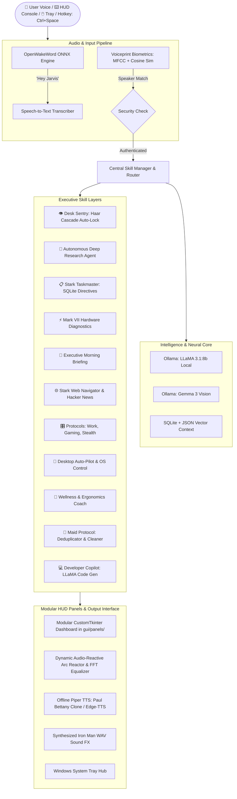

# J.A.R.V.I.S. (Just A Rather Very Intelligent System)
### *Next-Generation Autonomous Desktop AI Assistant & Sci-Fi Neural Interface*

[](https://www.python.org/)
[](https://ollama.ai/)
[](https://github.com/TomSchimansky/CustomTkinter)
[](tests/)
[](https://www.microsoft.com/)

---

## 🌌 Overview

**J.A.R.V.I.S.** is an open-source, locally hosted autonomous AI desktop assistant inspired by Tony Stark's iconic system. Engineered with a **modular skill-based architecture**, J.A.R.V.I.S. integrates **local Large Language Models (LLaMA 3.1:8b)**, **multimodal screen & camera vision**, **acoustic speaker biometrics**, **computer vision desk security**, and a **hardware-accelerated sci-fi HUD** with decoupled panel components.

Operating entirely offline for core tasks with zero cloud subscription lock-in, J.A.R.V.I.S. manages technical research synthesis, hardware thermal diagnostics, voice-authenticated workstation locks, media control, and daily executive morning briefings.

---

## 🏛️ System Architecture



---

## 📊 Implementation Status & Verification Matrix

To provide full transparency, features are categorized by current verification status:

| Subsystem | Feature | Status | Notes |
| :--- | :--- | :---: | :--- |
| **HUD & GUI** | Modular Panels (`gui/panels/`) | `✔ Stable` | Decoupled telemetry, reactor, media, directives, environment, and controls. |
| **HUD & GUI** | Dynamic Arc Reactor & 36-Band FFT Equalizer | `✔ Stable` | Real-time Tkinter canvas animations with mic reactivity. |
| **HUD & GUI** | Global Hotkey (`Ctrl + Space`) & System Tray | `✔ Stable` | Instant summon/minimize via Windows API `RegisterHotKey`. |
| **Skill Router** | 41 Modular Skills Engine | `✔ Stable` | Priority-based routing, zero-failure dynamic imports. |
| **Skill Router** | YouTube Search & Extraction | `✔ Stable` | Distinguishes YouTube search queries from Spotify music directives. |
| **Environment** | Resilient Weather Controller | `✔ Stable` | Tomorrow.io $\rightarrow$ zero-key Open-Meteo fallback $\rightarrow$ cache. |
| **Task Directives**| Stark Taskmaster | `✔ Stable` | SQLite-backed directive checklist with interactive `✔` buttons. |
| **Developer Tools**| Coding Copilot (`coding_skill.py`) | `✔ Stable` | Synthesizes Python scripts and writes them to the Desktop. |
| **Computer Vision**| Hand Gesture Control (`gesture_skill.py`) | `✔ Stable` | MediaPipe neural hand tracking: open palm interrupt, air pinch volume, victory briefing, thumbs up/down. |
| **Local AI** | LLaMA 3.1:8b Local Chat & Reasoning | `⚡ Local Setup` | Requires local Ollama instance (`ollama pull llama3.1:8b`). |
| **Computer Vision**| Gemma 3 Screen Analysis & Webcam Inspection | `⚡ Local Setup` | Requires Ollama vision model + local webcam device. |
| **Biometrics** | Voiceprint Speaker Authentication | `⚡ Experimental` | MFCC acoustic extraction; calibrates to individual speaker timber. |
| **Desk Sentinel** | Webcam Sentry Auto-Lock | `⚡ Experimental` | OpenCV Haar Cascade presence detector auto-locks Windows when away. |
| **Voice Engine** | Piper TTS Bettany Clone | `⚡ Experimental` | Local neural TTS model (`en_GB-alan-medium.onnx`) with Edge-TTS auto-fallback. |

---

## 🗂️ Project Structure

```
Jarvis/
├── assets/
│   ├── icons/               # Multi-resolution J.A.R.V.I.S. application icons (.ico)
│   ├── security/            # User voiceprint templates & biometric configs (.npy, .json)
│   └── sounds/              # Synthesized Iron Man acoustic sound effects (.wav)
├── ai_brain/
│   ├── ai_brain.py          # Ollama local LLM interface (LLaMA 3.1:8b)
│   ├── ai_modes.py          # Personality mode definitions
│   └── brain.py             # Memory & entity context resolution
├── background_tasks/
│   ├── battery_monitor.py   # Proactive AC/DC power listener
│   ├── focus_guard.py       # Deep work distraction enforcer
│   ├── reminder_manager.py  # Asynchronous timer and reminder scheduler
│   ├── sentry_guard.py      # OpenCV Haar Cascade webcam desk presence sentinel
│   └── wellness_monitor.py  # Continuous screen-time & hydration monitor
├── core/
│   ├── assistant.py         # Main event loop, command worker & proactive services
│   └── skill_manager.py     # Dynamic modular skill discovery & priority dispatcher
├── gui/
│   ├── gui.py               # Clean coordinator shell (~450 lines)
│   ├── tray_manager.py      # Windows System Tray notification area integration
│   └── panels/              # Modular HUD Panel Components
│       ├── __init__.py      # Package exports
│       ├── controls_panel.py# Hardware sliders, vision & diagnostic triggers
│       ├── environment_panel.py # Real-time clock & live weather fetcher
│       ├── media_panel.py   # Live track metadata polling & controls
│       ├── reactor_panel.py # Arc Reactor, Radar Compass & 36-band FFT equalizer
│       ├── telemetry_panel.py # CPU/RAM radial gauges, network speedometer, badges
│       └── todo_panel.py    # Stark Taskmaster SQLite checklist
├── memory_layer/
│   ├── fact_extractor.py    # Structured memory extraction
│   ├── memory.py            # JSON conversational persistence
│   └── sqlite_memory.py     # SQLite structured relational storage
├── skills/                  # 41 Modular Voice & Automation Skills
│   ├── briefing_skill.py    # Tony Stark executive morning briefing
│   ├── coding_skill.py      # Developer AI Copilot
│   ├── diagnostics_skill.py # Mark VII hardware telemetry
│   ├── focus_skill.py       # Focus Guard Pomodoro timer
│   ├── maid_skill.py        # Maid protocol deduplicator
│   ├── research_skill.py    # Autonomous Deep Research agent
│   ├── sentry_skill.py      # Desk Sentinel & Workstation Lock
│   ├── todo_skill.py        # Stark Taskmaster directives
│   ├── youtube_skill.py     # YouTube search query extractor
│   └── ...                  # 30+ additional system & media skills
├── system_layer/
│   ├── briefing_controller.py   # Morning briefing compiler
│   ├── diagnostics_controller.py# Hardware telemetry profiler
│   ├── maid_controller.py       # File deduplicator & organizer
│   ├── weather_controller.py    # Multi-tier resilient weather controller
│   └── web_agent.py             # Live web intelligence scraper
├── tests/                   # Automated Unit Test Suite
│   ├── test_gui_panels.py   # Tests modular HUD panel interfaces
│   ├── test_skills.py       # Tests skill router, priorities, and triggers
│   ├── test_voice_normalization.py # Tests symbol mapping and speech filters
│   └── test_weather.py      # Tests multi-tier zero-key weather fallback
├── voice_engine/
│   ├── piper_engine.py      # Offline Piper TTS wrapper (Paul Bettany clone)
│   ├── sound_effects.py     # Synthesized audio effects player
│   └── voice.py             # Audio dispatch & speech routing
├── wake_word.py             # Local ONNX wake word detection engine
├── main.py                  # Entrypoint bootstrap
├── Launch_JARVIS.vbs        # 1-Click invisible standalone background launcher
├── Stop_JARVIS.bat          # 1-Click clean process terminator
└── requirements.txt         # Python dependencies
```

---

## ⚡ Quickstart & Installation

### Prerequisites
1. **Windows 10 or 11** (64-bit)
2. **Python 3.11+** installed and added to `PATH`
3. *(Optional for Local AI)* **Ollama** installed:
   ```bash
   ollama pull llama3.1:8b
   ollama pull gemma:2b
   ```

### 1. Clone & Set Up Virtual Environment
```powershell
git clone https://github.com/Pothinasreeram/Jarvis.git
cd Jarvis

# Create virtual environment
python -m venv .venv
.\.venv\Scripts\Activate.ps1

# Install dependencies
pip install -r requirements.txt
```

### 2. Environment Configuration (Zero-Key by Default)
J.A.R.V.I.S. runs out-of-the-box with **zero required API keys**!
* Weather resolves automatically via the public Open-Meteo API.
* Speech synthesis auto-routes to high-fidelity Edge-TTS or local SAPI5.

If you wish to configure optional third-party integrations (such as Spotify or Tomorrow.io), copy the example configuration:
```powershell
cp .env.example .env
```
> **Security Note:** `.env` is permanently excluded via `.gitignore` to prevent secret exposure. Never commit personal keys.

### 3. Run the Automated Test Suite
Verify your installation and subsystem integrity before running:
```powershell
python -m unittest discover -s tests -p "test_*.py" -v
```

### 4. Launch J.A.R.V.I.S.
* **Standard Launch (Console + HUD):**
  ```powershell
  python main.py
  ```
* **Standalone Desktop Launcher:**
  Double-click `Launch_JARVIS.vbs` for a borderless standalone desktop experience with System Tray integration.
* **Stop Application:**
  Run `Stop_JARVIS.bat` to terminate all background daemons cleanly.

---

## 🗣️ Voice Directive Cheat-Sheet

| Category | Voice / Console Command | Result |
| :--- | :--- | :--- |
| **Morning Briefing** | `"good morning"` / `"morning briefing"` | Executive audio brief: weather, tasks, hardware, headlines & water. |
| **Developer Copilot** | `"write python code to scrape a website"` | Generates production code with LLaMA and saves to Desktop. |
| **YouTube Search** | `"search youtube for lo-fi beats"` | Extracts query and opens YouTube search results in browser. |
| **Hardware Diagnostics** | `"system diagnostics"` / `"mark vii status"` | Complete hardware profile (CPU GHz, RAM, GPU, thermals, health index). |
| **Hand Gestures** | `"activate gesture control"` / `"turn on gestures"` | Enables webcam neural hand tracking for air volume & speech interrupts. |
| **Desk Sentinel** | `"activate sentry mode"` / `"lock workstation"` | Arms webcam face detection; auto-locks Windows when you walk away. |
| **Voice Biometrics** | `"enroll voiceprint"` / `"verify voiceprint"` | Calibrates and authenticates your unique acoustic voice timbre. |
| **Autonomous Research** | `"research <topic>"` | Synthesizes a 4-section executive brief & saves Markdown to Desktop. |
| **Tech Intelligence** | `"tech news"` / `"hacker news"` | Speaks the top trending stories from the Hacker News API. |
| **Task Directives** | `"add task <directive>"` / `"what are my tasks"` | Logs to SQLite and updates HUD checklist in real time. |
| **Wellness & Posture** | `"log a glass of water"` / `"posture check"` | Increments daily water count; provides 20-20-20 ergonomic stretch advice. |
| **Work Protocols** | `"activate work protocol"` / `"gaming mode"` | Automates window snapping, volume, brightness, and deep work timers. |
| **Maid Protocol** | `"maid protocol"` / `"clean downloads"` | Automatically organizes folders and purges duplicate files. |
| **Music Playback** | `"play <song name> on spotify"` | Hands-free Spotify media playback. |
| **HUD Summon** | `Ctrl + Space` (Global Hotkey) | Instantly brings J.A.R.V.I.S. to the foreground or minimizes to Tray. |

---

## 👨‍💻 Author & Acknowledgments

* **Architect & Developer:** [Pothina Sreeram](https://github.com/Pothinasreeram)
* **Inspiration:** J.A.R.V.I.S. from Marvel's *Iron Man*
* **Special Thanks:** CustomTkinter, Ollama, OpenWakeWord, and Rhasspy Piper teams.

---

<p align="center">
  <i>"Sometimes you gotta run before you can walk." — Tony Stark</i>
</p>
