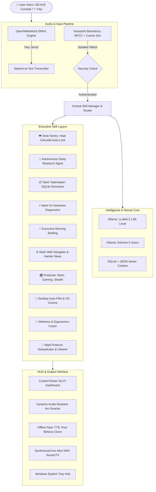

# J.A.R.V.I.S. (Just A Rather Very Intelligent System)
### *Next-Generation Autonomous Desktop AI Assistant & Iron Man Neural Interface*

[](https://www.python.org/)
[](https://ollama.ai/)
[](https://github.com/TomSchimansky/CustomTkinter)
[](https://opencv.org/)
[](https://github.com/rhasspy/piper)
[](https://www.microsoft.com/)

---

## 🌌 Overview

**J.A.R.V.I.S.** is a production-grade, 100% locally hosted autonomous AI desktop assistant inspired by Tony Stark's iconic system. Engineered with a **modular skill-based architecture**, J.A.R.V.I.S. combines **local Large Language Models (LLaMA 3.1:8b)**, **Multimodal Vision (Gemma 3 Vision)**, **acoustic speaker biometrics**, **computer vision desk security**, and a **hardware-accelerated sci-fi HUD** to deliver an unprecedented hands-free operating system experience on Windows.

Operating entirely offline for core tasks with zero cloud latency or subscription lock-in, J.A.R.V.I.S. handles everything from deep technical research synthesis, hardware thermal diagnostics, and voice-authenticated workstation locks to media conversions and daily executive morning briefings.

---

## 🏛️ System Architecture



---

## 🚀 Key Features & Capabilities

### 1. 🧠 Neural Intelligence & Computer Vision
* **Local LLaMA 3.1 (8B Parameters):** Ultra-fast local conversational reasoning with persistent multi-turn conversational memory.
* **Gemma 3 Multimodal Vision:** 1-click or voice-triggered screen and webcam visual analysis (*"Describe what is on my screen"* / *"Identify objects in view"*).
* **Smart Memory Engine:** Persists preferences, project facts, and context across reboots in `jarvis_memory.db`.

### 2. 🎙️ Paul Bettany Voice Clone & Audio-Reactive HUD
* **Offline Neural TTS:** Powered by local `piper` using an authentic British voice model (`en_GB-alan-medium.onnx`).
* **Zero-Cloud Wake Engine:** Continuous offline detection of *"Hey Jarvis"* powered by quantized ONNX models (< 1% CPU utilization).
* **Audio-Reactive Visualizer:** Real-time mathematical FFT frequency equalizer and dynamic pulsing Arc Reactor core that expands in sync with speech waveforms.
* **Sound FX Engine:** Authentic Iron Man acoustic chimes synthesized in code (`wake.wav`, `ack.wav`, `complete.wav`, `standby.wav`, `alert.wav`).

### 3. 🔐 Biometric Security & Desk Sentinel
* **Webcam Face Recognition Sentry Mode:** Micro-samples the webcam using OpenCV Haar cascades with zero persistent device locks. If you step away from your desk for > 90 seconds, J.A.R.V.I.S. secures Windows via `ctypes.windll.user32.LockWorkStation()` and welcomes you back upon return.
* **Acoustic Voiceprint Biometrics:** Enrolls your unique vocal profile via **Mel-Frequency Cepstral Coefficients (MFCCs)** and **spectral centroid** vector normalization. Sensitive commands require vocal timbre cosine verification (≥ 75% match).

### 4. 🧠 Autonomous Deep Research & Stark Web Agent
* **Autonomous Intelligence Briefs:** Directives like *"Jarvis, research quantum computing"* perform multi-query DuckDuckGo searches, scrape source content, synthesize an executive 4-section report via LLaMA 3.1, and save a formatted Markdown document to your Desktop.
* **Live Web Navigator:** Direct integration with the Hacker News API to retrieve real-time tech breakthroughs, plus on-the-fly article summarization for any URL.

### 5. ⚡ Mark VII Diagnostics & Executive Morning Briefing
* **Hardware Thermal Telemetry:** Profiles CPU clock speeds (GHz), 16-thread saturation, RAM allocation, GPU adapter stats, and computes an overall **System Health Index (0–100%)**.
* **Tony Stark Morning Briefing:** Directives like *"good morning"* prompt J.A.R.V.I.S. to deliver a seamless audio-visual intelligence briefing covering local atmospheric weather, pending task directives, hardware health, top global tech news, and daily hydration progress.

### 6. 📋 Live HUD To-Do Tracker ("Stark Taskmaster")
* Real-time pending objective tracker backed by SQLite.
* Sits natively in the HUD right column with glowing cyan headers, pending count, and interactive `✔` buttons to mark tasks complete with a click.

### 7. 🧘 Desk Ergonomics & Health Coach ("Wellness Protocol")
* **Continuous Screen-Time Monitor:** Uses Windows `GetLastInputInfo` to track continuous keyboard/mouse activity without polling overhead.
* **20-20-20 Break Nudges:** Alerts you after 50 continuous minutes of desk work to roll your shoulders, stretch, and rest your eyes.
* **Daily Hydration Tracker:** Logs water intake towards an 8-glass daily target with hourly reminder nudges.

### 8. 🎛️ Automation, Protocols & Swiss-Army Media Knife
* **System Protocols:** 1-word workstation reconfigurations (`Work Mode`, `Gaming Mode`, `Night Mode`, `Stealth Mode`).
* **Desktop Auto-Pilot:** Native window snapping, application launching, typing dictation, and volume/brightness sliders.
* **Maid Protocol:** Automatic organization of clutter and SHA-256 deduplication in `Downloads` and `Desktop`.
* **Media Swiss Knife:** Local audio extraction from videos, PDF text summarization, and batch image conversions powered by local FFmpeg and Pillow.
* **System Tray Hub & Global Hotkey:** Runs quietly in the Windows notification area with a global `Ctrl + Space` toggle shortcut.

---

## 🗂️ Project Structure

```
Jarvis/
├── assets/
│   ├── icons/               # Multi-resolution J.A.R.V.I.S. application icons (.ico)
│   ├── security/            # User voiceprint templates & biometric configs (.npy, .json)
│   └── sounds/              # Synthesized Iron Man acoustic sound effects (.wav)
├── ai_brain/
│   ├── ai_brain.py          # Ollama local LLM interface (LLaMA 3.1:8b)
│   ├── ai_modes.py          # Personality mode definitions
│   └── brain.py             # Memory & entity context resolution
├── background_tasks/
│   ├── battery_monitor.py   # Proactive AC/DC power listener
│   ├── focus_guard.py       # Deep work distraction enforcer
│   ├── reminder_manager.py  # Asynchronous timer and reminder scheduler
│   ├── sentry_guard.py      # OpenCV Haar Cascade webcam desk presence sentinel
│   └── wellness_monitor.py  # Continuous screen-time & hydration monitor
├── core/
│   ├── assistant.py         # Main event loop, command worker & proactive services
│   └── skill_manager.py     # Dynamic modular skill discovery & priority dispatcher
├── gui/
│   ├── gui.py               # CustomTkinter sci-fi HUD with Arc Reactor & Telemetry
│   └── tray_manager.py      # Windows System Tray notification area integration
├── memory_layer/
│   ├── fact_extractor.py    # Structured memory extraction
│   ├── memory.py            # JSON conversational persistence
│   └── sqlite_memory.py     # SQLite structured relational storage
├── skills/                  # 41 Modular Voice & Automation Skills
│   ├── briefing_skill.py    # Tony Stark executive morning briefing
│   ├── diagnostics_skill.py # Mark VII hardware telemetry
│   ├── focus_skill.py       # Focus Guard Pomodoro timer
│   ├── maid_skill.py        # Maid protocol deduplicator
│   ├── protocol_skill.py    # Multi-app workstation protocols
│   ├── research_skill.py    # Autonomous Deep Research agent
│   ├── sentry_skill.py      # Desk Sentinel & Workstation Lock
│   ├── todo_skill.py        # Stark Taskmaster directives
│   ├── voiceprint_skill.py  # Biometric speaker verification
│   ├── web_navigator_skill.py # Hacker News & URL summarizer
│   └── ...                  # 30+ additional system & media skills
├── system_layer/
│   ├── briefing_controller.py   # Morning briefing compiler
│   ├── diagnostics_controller.py# Hardware telemetry profiler
│   ├── maid_controller.py       # File deduplicator & organizer
│   ├── protocol_controller.py   # Workstation macro executor
│   ├── research_agent.py        # Multi-query DuckDuckGo synthesis agent
│   ├── todo_controller.py       # SQLite directives database manager
│   ├── voiceprint_security.py   # MFCC acoustic feature extractor
│   └── web_agent.py             # Live web intelligence scraper
├── voice_engine/
│   ├── piper_engine.py      # Offline Piper TTS wrapper (Paul Bettany clone)
│   ├── sound_effects.py     # Synthesized audio effects player
│   └── voice.py             # Audio dispatch & speech routing
├── wake_word.py             # Local ONNX wake word detection engine
├── main.py                  # Entrypoint bootstrap
├── Launch_JARVIS.vbs        # 1-Click invisible standalone background launcher
├── Stop_JARVIS.bat          # 1-Click clean process terminator
└── requirements.txt         # Python dependencies
```

---

## 🛠️ Tech Stack & Dependencies

| Layer | Technologies |
| :--- | :--- |
| **Language** | Python 3.11+ |
| **Local LLM & Vision** | Ollama, LLaMA 3.1:8b, Gemma 3 Vision |
| **Speech & Audio** | Piper TTS (`en_GB-alan-medium`), OpenWakeWord, PyAudio, Pygame, SciPy |
| **Vision & Biometrics**| OpenCV (`cv2`), Haar Cascade Classifier, NumPy, SciPy (STFT & DCT) |
| **GUI & HUD** | CustomTkinter, Tkinter Canvas, PIL/Pillow, Pystray |
| **System Automation** | PSUtil, WMI, PyWin32, PyAutoGUI, Screen Brightness Control, PyCaw |
| **Web & Scraping** | Requests, BeautifulSoup4 (`bs4`), DuckDuckGo Search (`ddgs`) |
| **Persistence** | SQLite3, JSON Local Cache |

---

## ⚡ Quickstart & Installation

### Prerequisites
1. **Windows 10 or 11** (64-bit)
2. **Python 3.11+** installed and added to `PATH`
3. **Ollama** installed:
   ```bash
   ollama pull llama3.1:8b
   ollama pull gemma:2b
   ```

### 1. Clone & Set Up Virtual Environment
```powershell
git clone https://github.com/Pothinasreeram/Jarvis.git
cd Jarvis

# Create virtual environment
python -m venv .venv
.\.venv\Scripts\Activate.ps1

# Install dependencies
pip install -r requirements.txt
```

### 2. Configure Environment Variables
Create a `.env` file in the root directory (optional overrides):
```env
WEATHER_API_KEY=your_openweathermap_key_optional
DEFAULT_CITY=Vadodara
```

### 3. Launch J.A.R.V.I.S.
* **Standard Launch (Console + HUD):**
  ```powershell
  python main.py
  ```
* **Standalone Desktop Launcher:**
  Double-click `Launch_JARVIS.vbs` or the created Desktop shortcut for a clean, borderless standalone desktop experience with System Tray integration.
* **Stop Application:**
  Run `Stop_JARVIS.bat` to terminate all background daemons cleanly.

---

## 🗣️ Voice Directive Cheat-Sheet

| Category | Voice / Console Command | Result |
| :--- | :--- | :--- |
| **Morning Briefing** | `"good morning"` / `"morning briefing"` | Executive audio brief: weather, tasks, hardware, headlines & water. |
| **Hardware Diagnostics** | `"system diagnostics"` / `"mark vii status"` | Complete hardware profile (CPU GHz, RAM, GPU, thermals, health index). |
| **Desk Sentinel** | `"activate sentry mode"` / `"lock workstation"` | Arms webcam face detection; auto-locks Windows when you walk away. |
| **Voice Biometrics** | `"enroll voiceprint"` / `"verify voiceprint"` | Calibrates and authenticates your unique acoustic voice timbre. |
| **Autonomous Research** | `"research <topic>"` | Synthesizes a 4-section executive brief & saves Markdown to Desktop. |
| **Tech Intelligence** | `"tech news"` / `"hacker news"` | Speaks the top trending stories from the Hacker News API. |
| **Task Directives** | `"add task <directive>"` / `"what are my tasks"` | Logs to SQLite and updates HUD checklist in real time. |
| **Wellness & Posture** | `"log a glass of water"` / `"posture check"` | Increments daily water count; provides 20-20-20 ergonomic stretch advice. |
| **Work Protocols** | `"activate work protocol"` / `"gaming mode"` | Automates window snapping, volume, brightness, and deep work timers. |
| **Maid Protocol** | `"maid protocol"` / `"clean downloads"` | Automatically organizes folders and purges duplicate files. |
| **Music Playback** | `"play <song name> on spotify"` | Hands-free Spotify media playback. |
| **HUD Summon** | `Ctrl + Space` (Global Hotkey) | Instantly brings J.A.R.V.I.S. to the foreground or minimizes to Tray. |

---

## 👨‍💻 Author & Acknowledgments

* **Architect & Developer:** [Pothina Sreeram](https://github.com/Pothinasreeram)
* **Inspiration:** J.A.R.V.I.S. from Marvel's *Iron Man*
* **Special Thanks:** Rhasspy Piper TTS team, Ollama community, and CustomTkinter developers.

---

<p align="center">
  <i>"Sometimes you gotta run before you can walk." — Tony Stark</i>
</p>
